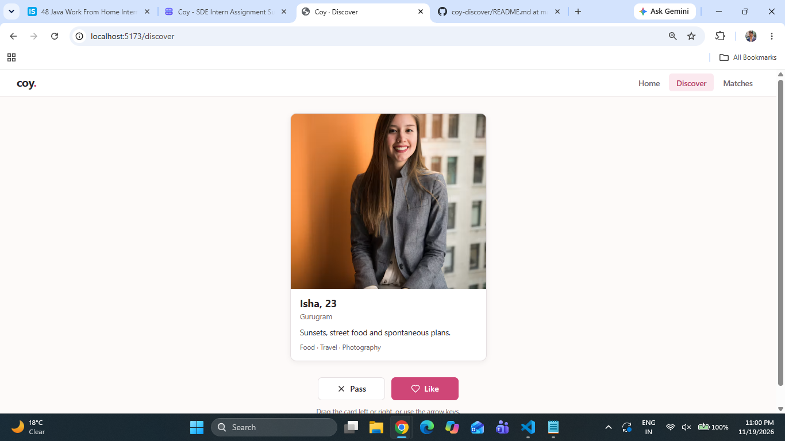
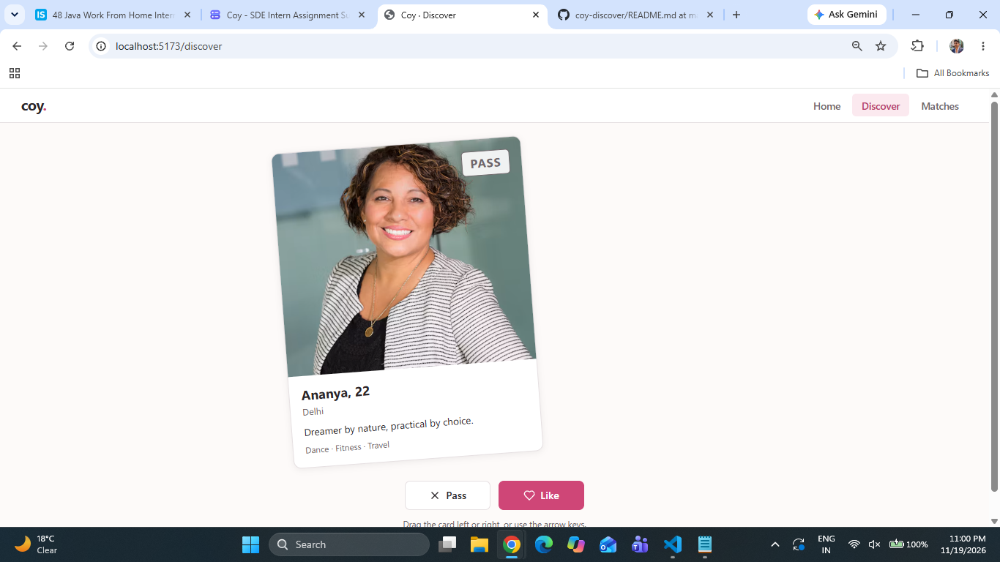
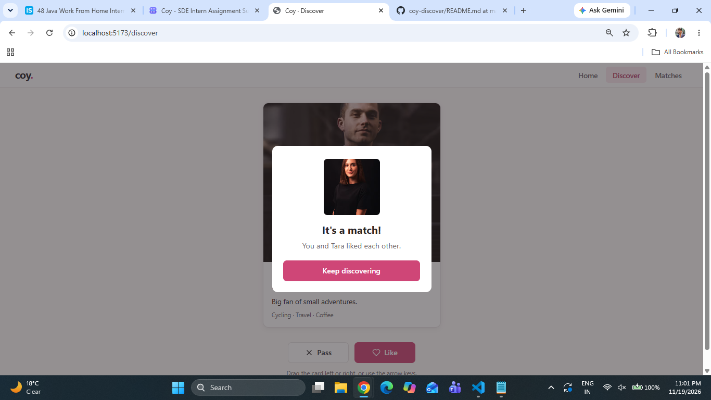
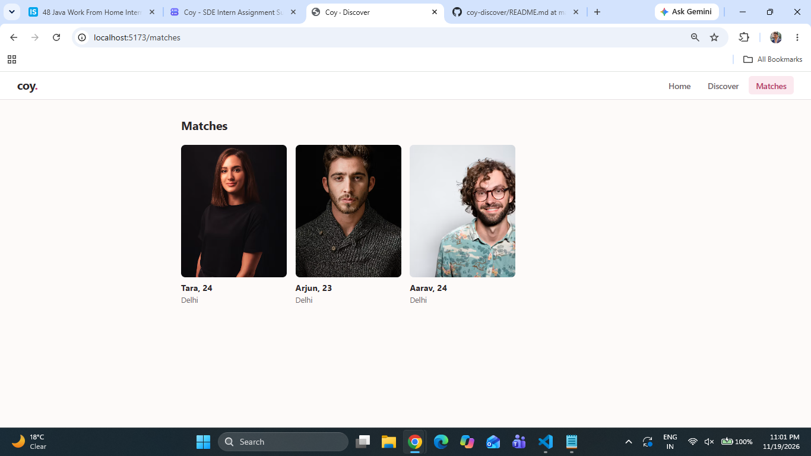

# Coy Discover

A standalone, mobile-first implementation of Coy's Discover assignment, featuring swipe-based profile discovery and mutual matching.

## Screenshots

### Discover


### Swipe Interaction


### Match Confirmation


### Matches


## Tech Stack

- React + Vite
- Node.js + Express
- SQLite using Node.js built-in `node:sqlite`
- Framer Motion
- Axios
- Lucide React

## Requirements

- Node.js 22.13 or newer (developed using Node.js 24).
- npm

Note: Node.js may display an experimental warning for `node:sqlite` during startup. This is expected.

## Run Locally

Clone the repository:

```bash
git clone https://github.com/Harsh5453/coy-discover.git
cd coy-discover
```

### 1. Start the Backend

Open a terminal:

```bash
cd server
npm install
npm run dev
```

Backend runs at: http://localhost:4000

### 2. Start the Frontend

Open a second terminal from the project root:

```bash
cd client
npm install
npm run dev
```

Frontend runs at: http://localhost:5173

Both the backend and frontend must be running simultaneously.

## Database

- SQLite database is created automatically at `server/data/coy.sqlite`.
- 32 fictional demo profiles are seeded on the first launch.
- A single demo user (`me`) is assumed, as permitted by the assignment.
- Swipes and matches persist across application restarts.

## API Endpoints

| Method | Endpoint | Description |
|---|---|---|
| GET | `/feed` | Fetch profiles not yet swiped on |
| POST | `/swipe` | Submit a Like or Pass action |
| GET | `/matches` | Fetch mutual matches |
| GET | `/health` | Optional server health check |

### Swipe Request Example

```json
{
  "profileId": 1,
  "action": "like"
}
```

Valid actions: `like` or `pass`.

## Privacy Rules

- Incoming like status is never revealed in the feed. Profiles are displayed like any other profile.
- `/feed` does not expose the `likesYou` seed field.
- `/matches` returns only mutual matches.
- A match is created only when the current user likes a profile that has already liked the current user.
- Duplicate swipes are rejected.
- Swipes and matches are persisted in SQLite.

## Application Pages

- **Home:** Intentionally blank, as specified in the assignment.
- **Discover:** One profile card at a time, with drag gestures, Like/Pass buttons and keyboard arrow-key navigation.
- **Matches:** Displays profiles with mutual matches.

## Reset Demo Data

Stop the backend server and delete:

- `server/data/coy.sqlite`
- `server/data/coy.sqlite-shm` (if present)
- `server/data/coy.sqlite-wal` (if present)

Restart the backend to recreate the database and seed the demo profiles.

You can also set the `DATA_DIR` environment variable to use a different database location.

## Notes

- All people and profile details are fictional demo data.
- Profile photos are sourced from Unsplash and loaded through remote image URLs.
- An internet connection is required to display profile photos.
- If an image fails to load, the card displays a fallback placeholder.
